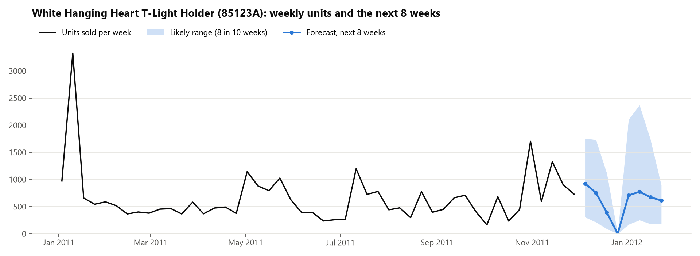
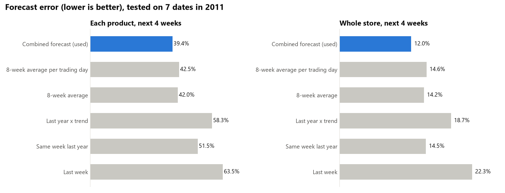
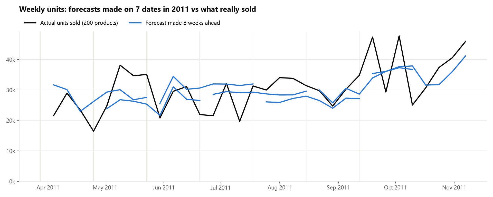
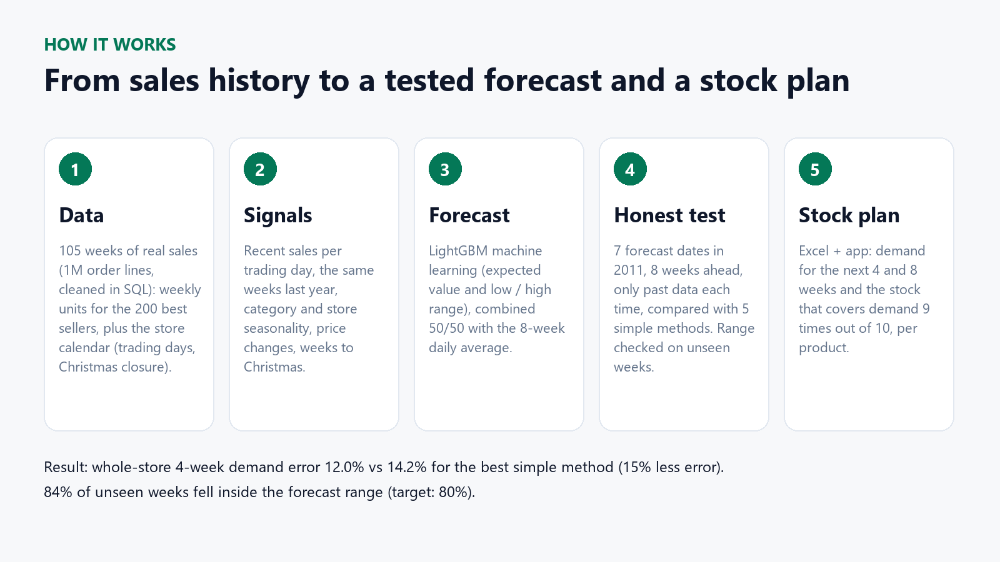
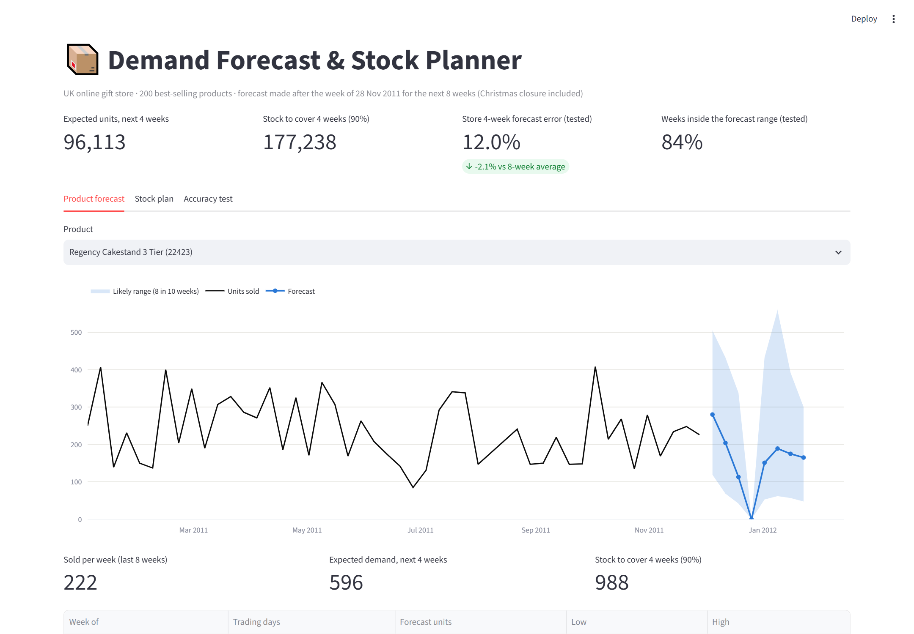
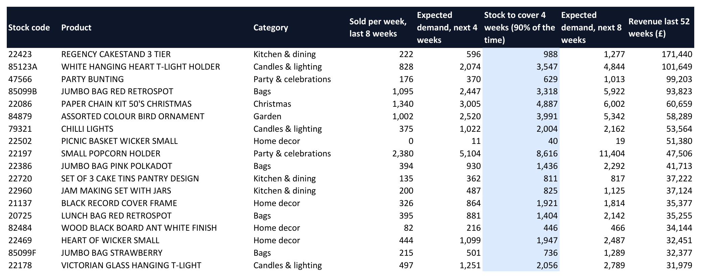

# Demand Forecast & Stock Planner (weekly sales forecasting per product)

Weekly demand forecasts for the **200 best-selling products** of a UK online gift store, 8 weeks ahead, with a
low-high range for every week and a **stock plan**: the stock that covers the next 4 weeks of demand 9 times out of 10.
Real sales data: UCI Online Retail II, 1.07M order lines (Dec 2009 to Dec 2011), cleaned in SQL in the
[Power BI project](https://github.com/Tadrous-William/powerbi-sales-dashboard).



## Honest accuracy test

The forecast was made on **7 dates in 2011** (every 4 weeks from 28 Mar to 12 Sep). Each time only the weeks before
that date were used, the next 8 weeks were forecast and compared with what really sold (9,694 product-weeks).
It is compared with 5 simple methods a business would otherwise use.



| Forecast error (WAPE, lower is better) | Each product, 4 weeks | Whole store, 4 weeks | Each product, 1 week |
|---|---:|---:|---:|
| **Combined forecast (used)** | **39.4%** | **12.0%** | 57.5% |
| 8-week average | 42.0% | 14.2% | 58.8% |
| Same week last year | 51.5% | 14.5% | 80.6% |
| Last year x trend | 58.3% | 18.7% | 86.6% |
| Last week | 63.5% | 22.3% | 74.5% |

- **15% less error** than the best simple method on whole-store demand 4 weeks ahead; 6% less per product.
- **Ranges you can plan with:** calibrated on the first 4 dates and checked on the last 3, 84% of real weeks fell inside
  the low-high range (target 80%) and 90.5% were below "high" (target 90%).
- Single product-weeks stay hard to predict (wholesale customers place a few very large orders), which is why the
  stock plan works with 4-week totals and ranges rather than single-week point forecasts.



## How it works



1. `src/prepare_data.py`: weekly units per product and the store calendar (trading days, Christmas closure, Easter).
2. `src/forecast.py`: features per product and forecast date (recent sales **per trading day**, last year's same
   weeks, category and store seasonality, price changes, weeks to Christmas); LightGBM quantile models (low / median /
   high) and a Tweedie model (expected value), trained on all products together; the final forecast is 50% model +
   50% 8-week daily average; ranges calibrated on the backtest.
3. `src/report.py`: Excel workbook (`output/forecast_next_8_weeks.xlsx`: Stock plan, Weekly forecast, Low-high range,
   Accuracy test) and the charts.
4. `app/app.py`: Streamlit app (product forecast, stock plan, accuracy).




## Run it

```bash
python -m venv .venv
.venv\Scripts\activate
pip install -r requirements.txt
python src/prepare_data.py     # needs the cleaned database from the Power BI project
python src/forecast.py         # backtest + next 8 weeks (about 3 minutes)
python src/report.py           # Excel + charts
start_app.bat                  # the app in your browser
```

Built by **Tadrous William**, data scientist.
